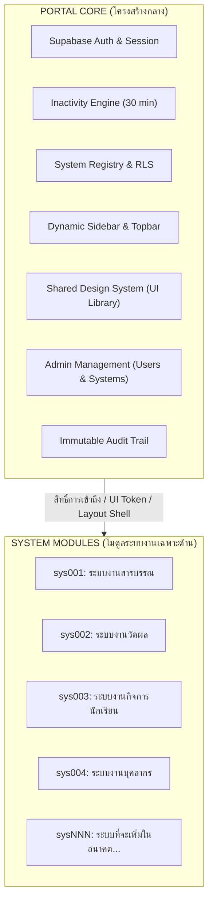

# สถาปัตยกรรมระบบ PCSK School Web Portal (Architecture Blueprint)

เอกสารโครงสร้างสถาปัตยกรรม แม่แบบการออกแบบ และแนวทางการขยายระบบอย่างยั่งยืนสำหรับ **โรงเรียนพิจิตรคริสเตียน (PCSK School)**

---

## 1. หลักการสถาปัตยกรรมระดับแกนนำ (Core Architectural Principles)

### "BUILD THE PORTAL ONCE. BUILD SYSTEMS AS MODULES."
ระบบพอร์ทัลถูกออกแบบโดยแยกออกเป็น 2 ชั้นอย่างเด็ดขาด:



* **Portal Core**: รับผิดชอบการยืนยันตัวตน, สิทธิ์การเข้าถึง (RBAC + RLS), Session Timeout, Navigation, UI Component กลาง, และหน้าจัดการ
* **System Modules**: รับผิดชอบเฉพาะ Business Logic และฟอร์มเฉพาะทางของตนเอง โดย**ต้องใช้ซ้ำ UI และ Layout ของ Core 100% ห้ามสร้างซ้ำซ้อน**

---

## 2. แผนผังโครงสร้างโปรเจกต์ (Project Directory Structure)

```text
PCSK - Webportal V2/
├── app/                          # Next.js App Router
│   ├── (portal)/                 # Authenticated Portal Core Routes
│   │   ├── admin/                # Super Admin Management (Systems, Users, Settings, Logs)
│   │   │   ├── audit-logs/       # Security & Activity Audit Trail
│   │   │   ├── settings/         # Central Portal Settings
│   │   │   ├── systems/          # System Registry CRUD
│   │   │   └── users/            # User Status & Role Assignment
│   │   ├── dashboard/            # Dynamic Database-Driven Dashboard
│   │   ├── design-system/        # Visual Design System Showcase
│   │   ├── systems/              # System Routing Gateway
│   │   │   ├── [code]/           # Dynamic Fallback & Maintenance Handler
│   │   │   └── sys001/           # Prototype Module: Official Correspondence
│   │   └── layout.tsx            # PortalShell + InactivityTracker Mount Point
│   ├── login/                    # Official School Login Page
│   ├── globals.css               # Tailwind Directives & portal_* Scoped CSS
│   ├── layout.tsx                # Root Layout (Google Fonts Prompt & Sarabun)
│   └── page.tsx                  # Public Landing Page & Readiness Indicator
│
├── components/
│   ├── admin/                    # Admin-specific Interactive Managers
│   ├── core/                     # Portal Core Components (Sidebar, Topbar, Footer, InactivityModal, PageHeader)
│   └── ui/                       # Shared Design System (Button, Input, Card, Badge, Modal, Table, etc.)
│
├── docs/                         # Centralized System Documentation
│   ├── ARCHITECTURE.md           # This document
│   ├── DATABASE_SCHEMA.md        # Relational Schema & RLS Policies
│   ├── DEPLOYMENT_GUIDE.md       # Vercel & Production Setup Guide
│   ├── DESIGN_SYSTEM.md          # UI Tokens & Component Usage Guide
│   └── SYSTEM_MODULE_GUIDE.md    # Developer Blueprint for adding sys002, sys003...
│
├── hooks/                        # Custom React Hooks (useInactivityTimeout)
├── lib/
│   ├── actions/                  # Next.js Server Actions (auth.ts, admin.ts)
│   ├── services/                 # Data Fetching Services (portal-data.ts, audit-log.ts)
│   ├── supabase/                 # Supabase SSR Clients (client.ts, server.ts, middleware.ts, admin.ts)
│   ├── constants.ts              # System Constants & Timeout Configs
│   └── utils.ts                  # cn() & Thai Date Formatters
│
├── supabase/
│   └── migrations/               # SQL Migration Files (Schema, RLS, Seed)
│
├── systems/                      # Isolated System Module Logic
│   └── sys001/                   # Official Correspondence Business Components & Services
│
└── types/                        # Core TypeScript Interfaces (portal.ts)
```

---

## 3. มาตรฐานความปลอดภัย (Security Architecture)

1. **Row Level Security (RLS)**: ทุกตารางใน Supabase มี RLS ควบคุมในระดับ Database Engine ผู้ใช้ไม่สามารถเรียก API เพื่อดูข้อมูลระบบที่ตนไม่มีสิทธิ์ได้
2. **Server-Side Authorization**: การตรวจสอบ Session ทำผ่าน `@supabase/ssr` บน Edge Middleware และ Next.js Server Components โดยไม่เชื่อถือ State บน Browser เพียงอย่างเดียว
3. **Inactivity Timeout**: ระบบ Inactivity Tracker ตรวจจับกิจกรรมผู้ใช้ และทำการตัดการเชื่อมต่ออัตโนมัติเมื่อไม่มีการเคลื่อนไหวครบ 30 นาที (ปรับได้ 15/30/60/120 นาที)
4. **Immutable Audit Trail**: ตาราง `db_audit_logs` อนุญาตเฉพาะคำสั่ง `INSERT` ห้ามแก้ไข (`UPDATE`) หรือลบ (`DELETE`) ทุกกรณี
5. **No Secret Leaks**: ความลับ `SUPABASE_SERVICE_ROLE_KEY` ถูกกักเก็บไว้เฉพาะฝั่งเซิร์ฟเวอร์เท่านั้น ไม่รั่วไหลไปยัง Client Bundle

---

## 4. มาตรฐานการออกแบบ (Design Consistency)

* **สีหลัก**: Slate / Zinc (กลาง), Green (Brand Accent), White (พื้นผิว)
* **ฟอนต์**: Prompt (หลัก) และ Sarabun (ทางการ) ขนาดเนื้อหาพื้นฐานไม่ต่ำกว่า **16px**
* **UX ภาษาไทย 100%**: ทุกข้อความ ทุกปุ่ม ทุกหัวตารางแสดงเป็นภาษาไทยทางการ ห้ามเปิดเผย Technical Database Names สู่ผู้ใช้เด็ดขาด
