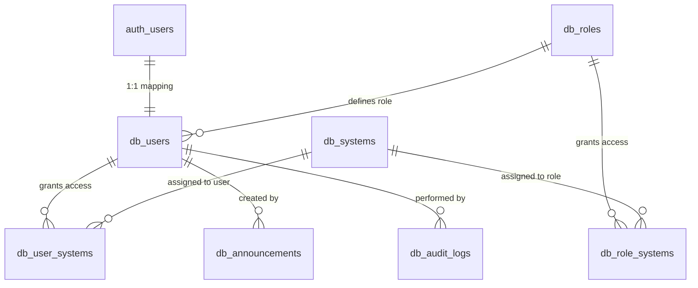

# โครงสร้างฐานข้อมูล PCSK School Web Portal (Supabase PostgreSQL)

เอกสารอธิบายสถาปัตยกรรมฐานข้อมูล ตาราง ความสัมพันธ์ และนโยบายความปลอดภัย (Row Level Security: RLS)

---

## 1. รายการตารางทั้งหมด (Tables Overview)

| ชื่อตาราง | คำอธิบายภาษาไทย | วัตถุประสงค์หลัก |
| :--- | :--- | :--- |
| `db_roles` | ตารางบทบาทผู้ใช้งาน | กำหนดระดับสิทธิ์ เช่น ผู้ดูแลระบบ, ผู้บริหาร, ครู, บุคลากร |
| `db_users` | ตารางข้อมูลผู้ใช้งาน (Profile) | เชื่อมโยง 1:1 กับ `auth.users` ของ Supabase Auth |
| `db_systems` | ตารางทะเบียนระบบกลาง (System Registry) | รวบรวมระบบงานย่อยทั้งหมด ไอคอน หมวดหมู่ และสถานะ |
| `db_user_systems` | ตารางสิทธิ์เข้าถึงระบบรายบุคคล | กำหนดสิทธิ์เพิ่มเติมเฉพาะบุคคลนอกเหนือจากบทบาท |
| `db_role_systems` | ตารางสิทธิ์เข้าถึงระบบตามบทบาท | กำหนดระบบเริ่มต้นที่แต่ละ Role เข้าถึงได้ |
| `db_announcements` | ตารางประกาศกลางและระดับระบบ | แสดงข่าวสารทั้งหน้า Login และ Dashboard |
| `db_portal_settings` | ตารางการตั้งค่าพอร์ทัลกลาง | ชื่อพอร์ทัล, โลโก้, ข้อความ Footer, เวลา Timeout |
| `db_audit_logs` | ตารางบันทึกประวัติการใช้งาน | บันทึกการเข้าใช้งาน การแก้ไขสิทธิ์ และกิจกรรมสำคัญ |

---

## 2. แผนผังความสัมพันธ์ (Entity-Relationship)

---

## 3. รายละเอียดโครงสร้างตารางหลัก

### 3.1 `db_systems` (ทะเบียนระบบกลาง)
แทนที่ DB_Systems เดิมจาก Google Sheets ด้วย Relational Database สมบูรณ์แบบ
- `id` (UUID PK)
- `system_code` (VARCHAR, Unique) - เช่น `sys001`, `sys002` (รหัสภายใน ซ่อนจากผู้ใช้ทั่วไป)
- `name` (VARCHAR, Unique) - เช่น `official_correspondence`
- `display_name` (VARCHAR) - ชื่อทางการภาษาไทย เช่น "ระบบงานสารบรรณอิเล็กทรอนิกส์"
- `description` (TEXT) - รายละเอียดหน้าที่ของระบบ
- `system_group` (VARCHAR) - หมวดหมู่: งานบริหาร, งานวิชาการ, งานบุคลากร, งานนักเรียน, งานสารสนเทศ, งานทั่วไป
- `icon_key` (VARCHAR) - คีย์อ้างอิงไอคอน Lucide เช่น `file-text`, `users`, `calendar-check`
- `route_or_url` (TEXT) - Application Route ภายใน หรือ URL ภายนอก (`https://...`)
- `system_type` (VARCHAR) - `'internal'` หรือ `'external'`
- `is_active` (BOOLEAN) - เปิด/ปิดการใช้งานระบบ
- `is_maintenance` (BOOLEAN) - โหมดปิดปรับปรุงระบบ
- `maintenance_message` (TEXT) - ข้อความชี้แจงเมื่อปิดปรับปรุง
- `sort_order` (INT) - ลำดับการแสดงผล

### 3.2 `db_users` (โปรไฟล์ผู้ใช้งาน)
- `id` (UUID PK) - เชื่อมโยงกับ `auth.users(id)`
- `email` (VARCHAR, Unique)
- `first_name` (VARCHAR)
- `last_name` (VARCHAR)
- `display_name` (VARCHAR)
- `role_id` (UUID FK) - อ้างอิง `db_roles(id)`
- `is_active` (BOOLEAN) - เปิด/ปิดการเข้าใช้งานของผู้ใช้
- `last_active_at` (TIMESTAMPTZ) - สำหรับติดตาม Inactivity

---

## 4. นโยบายความปลอดภัย Row Level Security (RLS)

1. **การควบคุมการเข้าถึงระบบ (`db_systems`)**:
   - ผู้ใช้ทั่วไปสามารถมองเห็นเฉพาะระบบที่ `is_active = true` และตนเองได้รับสิทธิ์ผ่าน `db_user_systems` หรือ `db_role_systems` เท่านั้น
   - `super_admin` สามารถมองเห็นและจัดการระบบได้ทั้งหมด
2. **การป้องกันการแก้ไขสิทธิ์**:
   - ผู้ใช้ทั่วไปสามารถอัปเดตได้เฉพาะข้อมูลส่วนตัว (`display_name`, `avatar_url`) แต่ไม่สามารถเปลี่ยน `role_id` หรือ `is_active` ของตนเองได้
3. **การรักษาความสมบูรณ์ของ Audit Logs**:
   - ตาราง `db_audit_logs` อนุญาตเฉพาะ `INSERT` สำหรับผู้ใช้ที่ผ่านการยืนยันตัวตน และไม่อนุญาตให้ `UPDATE` หรือ `DELETE` โดยเด็ดขาด (Immutable)

---

## 5. วิธีการนำ Migration ไปใช้งานบน Supabase

นำไฟล์ SQL ในโฟลเดอร์ `supabase/migrations/` ไปรันใน **Supabase SQL Editor** ตามลำดับ:
1. `20260926000001_initial_schema.sql` (สร้างตาราง, Index, Trigger)
2. `20260926000002_row_level_security.sql` (เปิดใช้งาน RLS และ Policies)
3. `20260926000003_seed_data.sql` (บันทึกข้อมูลเริ่มต้น Roles, Systems, Settings, Announcements)
